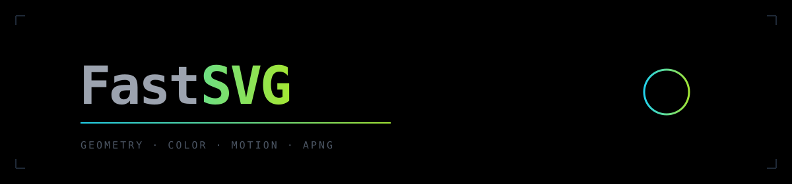
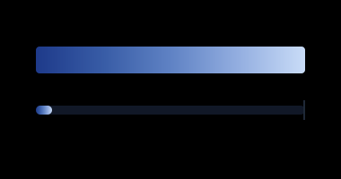

<div align="center">



**AI models shouldn't guess coordinates. FastSVG computes them.**

Geometry, color, motion and APNG — solved with math, exposed over MCP.

[]()
[]()
[]()
[]()

&nbsp;

| | | |
|:---:|:---:|:---:|
|  |  |  |

</div>

<br/>

## Install

```bash
git clone https://github.com/Syron01/fastsvg && cd fastsvg
npm install && npm test
```

```bash
npx tsx apps/cli/src/main.ts render scene.json --out out.png    # scene → PNG
npx tsx apps/cli/src/main.ts compare a.png b.png                # pixel diff
```

## Use with your model

```json
{ "mcpServers": { "fastsvg": { "command": "npx", "args": ["fastsvg-mcp"] } } }
```

> *"Animate the box 20px right, ease-in-out, export a 10fps APNG."*

Ten tools: `create_scene` · `apply_patch` · `build_path` · `create_gradient` · `render_png` · `export_apng` · `compare_images` · …

## What's inside

| | |
|---|---|
| **scene-ir** | typed scene model, atomic patches |
| **geometry** | exact Bézier bounds, arc length, reverse |
| **color-engine** | sRGB ↔ linear ↔ OKLab, WCAG contrast |
| **gradient-engine** | perceptual stops, ΔE banding report |
| **motion-engine** | keyframes, cubic-bezier, damped springs, loop-seam check |
| **raster** | alpha blending, 2×2 anti-aliased fills |
| **apng-exporter** | PNG/APNG codec written from scratch |
| **frame-pipeline** | scene + timeline → deterministic APNG |
| **vision** | pixel diff, changed-region bbox, silhouette IoU |

## Limits

Boolean ops, gradient raster fills and delta-frame APNG aren't implemented yet.
Everything shipped is tested — [full spec](docs/product-requirements.md) · [live demo](docs/demo.html).

<div align="center">
<sub>MIT</sub>
</div>
