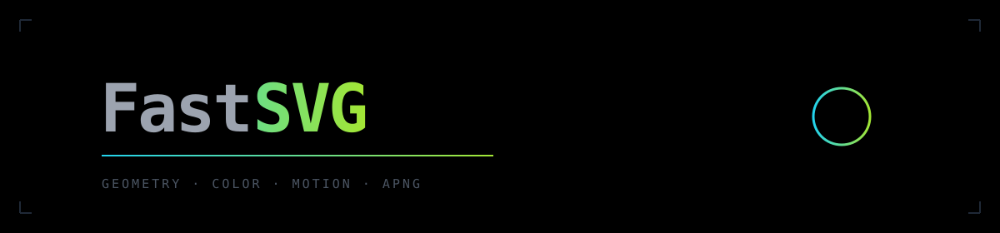

<div align="center">



**AI models shouldn't guess coordinates. FastSVG computes them.**

3D Geometry, isometric projections, presentation slides, web heroes, data charts, color and delta APNG — solved with math, exposed over MCP.

[]()
[]()
[]()
[]()

&nbsp;

| | | |
|:---:|:---:|:---:|
|  |  |  |

</div>

<br/>

## Install

```bash
git clone https://github.com/Syron01/fastsvg && cd fastsvg
npm install && npm test
```

## Use with your model (MCP + Skill)

FastSVG includes a dedicated **`fastsvg-designer`** skill and **16 MCP tools** that enable LLMs to create 3D isometric designs, presentation slides, landing page heroes, and data charts in a single, ultra-fast call:

```json
{ "mcpServers": { "fastsvg": { "command": "npx", "args": ["fastsvg-mcp"] } } }
```

### High-Level Turbo Tools:
- `fastsvg_render_3d`: Instant 3D boxes, cylinders, and mockup planes with Lambertian shading & isometric projection.
- `fastsvg_compose_slide`: 16:9 presentation slide templates with glassmorphic cards and isometric architecture visuals.
- `fastsvg_compose_web`: Modern landing page hero sections with navbar, typography, and floating window mockups.
- `fastsvg_render_chart`: Donut charts, smooth spline area waves, rounded bar charts, and gauge meters.
- `fastsvg_boolean_paths`: Union, intersection, difference, and xor on any SVG path.
- `fastsvg_analyze_quality`: G0/G1 tangency continuity and optical balance centroid calculations.
- `fastsvg_export_apng`: Sub-frame delta APNG compression (reduces file sizes by 70%+).

## What's inside

| | |
|---|---|
| **scene-ir** | typed scene model, atomic patches |
| **geometry** | 3D isometric & perspective engine, Bézier bounds, Boolean ops, slide/web templates, infographics |
| **color-engine** | sRGB ↔ linear ↔ OKLab/OKLCH, WCAG contrast |
| **gradient-engine** | perceptual stops, ΔE banding report |
| **motion-engine** | keyframes, cubic-bezier, damped springs, loop-seam check |
| **raster** | alpha blending, scanline AA fills, linear/radial gradient fills & strokes |
| **apng-exporter** | PNG/APNG codec with dirty-rect delta frame compression |
| **frame-pipeline** | scene + timeline → deterministic APNG (cached static layers) |
| **vision** | pixel diff, changed-region bbox, silhouette IoU, animation frame diff |

<div align="center">
<sub>MIT License</sub>
</div>
